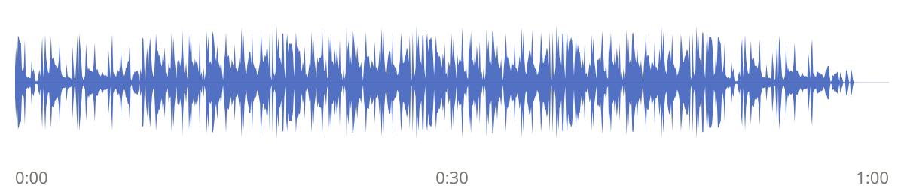

GPU를 사는 대신 빌려서 해본 일

# 5090은 안 샀다. 대신 빌려서 놀았다.

비싼 GPU를 집에 모셔 놓는 대신, 필요할 때만 꺼내 쓰면 어떨까.  
이번에는 ACE-Step 1.5로 60초 음악을 만들고, GPU를 언제 돌려줄지까지 재봤다.

실험: 2026.10.18 / 10.24 KST　·　단일 GPU　·　[발표용 슬라이드](slides.html)

좋은 소비철학이 있으면 돈이 생기나요

천이백만원쯤 들여서 5090을 산다고 쳐보자. 그리고 그 물건이 99%의 시간 동안 책상 아래에서 놀고 있다면.

아주 비싼 인테리어다. 성능은 훌륭한데 주로 하는 일은 방 안의 공기와 눈을 맞추는 것.

GPU를 살까 말까 고민할 때는 이상하게도 가장 열심히 쓸 날만 상상하게 된다. 새 모델이 공개되고, 남들은 메모리가 부족해서 못 돌린다는 걸 나는 집에서 돌려보고, 가끔은 작은 모델도 학습시킨다. 밤새 계산을 맡겨놓고 아침에 결과를 확인하는 멋진 생활. 그 장면 속의 나는 늘 할 일이 명확하고 의욕이 넘친다.

그런데 장비의 주인은 상상 속의 내가 아니라 평소의 나다. 모델을 돌리기 전에 논문을 읽다가 다른 글로 새고, 실행할 코드를 고치다가 오늘은 여기까지만 하자고 하고, 잘 되면 잘 되는 대로 며칠 안 건드릴 사람이다. 최고 성능이 필요한 순간은 선명하게 떠오르는데, 아무것도 안 돌리는 화요일 오후는 구매 계획서에 잘 등장하지 않는다.

그래픽카드가 나를 보고 일을 하라고 닦달해주면 좋겠지만, 그렇게 다정한 물건은 아니다. 안 쓰는 날에도 가격이 저절로 내려가 주는 것도 아니고. 내가 갖고 싶은 성능과 내가 꾸준히 소비할 계산량 사이에는 꽤 넓은 틈이 있을 것 같았다.

장비를 좋아하는 마음과 장비를 잘 쓰는 능력을 같은 것으로 취급하지 말자. 적어도 나한테는 이 말을 한번 해줄 필요가 있었다.

물론 남의 사용률을 내가 어떻게 알겠나. **내가 사면 그럴 것 같다는 얘기다.** 새 모델 나왔다고 며칠 신나게 돌려보다가, 코드를 고치고 자료를 읽고 다음에 뭘 해볼지 생각하는 시간이 더 길어질 사람. 나는 내가 안다. 장비를 산다고 갑자기 부지런해질 리도 없고.

1,200만원은 비싸게 사는 상황을 잡은 가정이고, 99%도 내 예상이다. 모든 5090의 시세나 사람들의 평균 유휴율이라는 뜻은 아니다. 실제 판매가격 얘기는 맨 아래에 출처와 함께 적었다.

그래서 안 샀다. 대신 RunPod에서 GPU를 빌렸다. 필요할 때 켜서 계산을 시키고, 결과를 챙긴 다음 지웠다. 집에 있던 GPU처럼 즉시 쓸 수 있는 건 아니지만, 적어도 비싼 물건을 일 년 내내 모시고 살 필요는 없었다.

나는 GPU가 필요한 사람이지, 꼭 GPU의 소유자가 되어야 하는 사람은 아닐 수 있다. 이 둘을 나누고 나니 질문이 좀 작아졌다. 평생 어느 쪽이 더 이득이냐는 거창한 결론부터 낼 필요 없이, 이번 주말에 해보고 싶은 실험을 빌린 장비로 무리 없이 끝낼 수 있는지만 확인하면 됐다.

물론 임대에도 귀찮음은 있다. 계정을 만들고, 키를 챙기고, 어떤 이미지로 켤지 정하고, 파일을 어디에 남길지 생각해야 한다. 로컬에서 터미널 하나 여는 경험과 같다고 말하면 안 된다. 이번에 해본 것도 그 귀찮음을 지운 척하는 일이 아니라, 한 번 정리한 준비물을 다음번에도 재사용하는 쪽이었다.

실험이 끝나면 사라져도 되는 것은 실행 환경이고, 사라지면 곤란한 것은 모델과 코드와 결과다. 둘을 처음부터 한 덩어리로 생각하면 원격 GPU는 매번 이삿짐을 새로 싸는 물건이 된다. 나눠놓으면 계산할 때만 방 하나 잠깐 빌리는 쪽에 가까워진다.

그게 말처럼 편한지, 그리고 편하다고 느끼기 위해 실제로 얼마를 기다려야 하는지가 궁금했다. 그래서 이번에는 ‘클라우드니까 편하겠지’에서 멈추지 않고 시계를 켰다.

여기까지 말하면 보통 첫 반론이 나온다. 원격 GPU는 켜는 데 오래 걸리지 않냐고.

## 그런데 그 작은 모델로는 좀 설득이 안 됐다

처음에는 작은 언어모델로 짧은 답변을 만들었다. Qwen2.5-1.5B-Instruct, 가중치 약 3.09GB. 모델과 준비물을 남긴 뒤 새 5090을 세 번 받았더니 첫 결과 회수까지 31.9초, 33.2초, 40.2초가 걸렸다. 없는 GPU를 빌려 결과까지 받는 데 이 정도면 꽤 괜찮다고 생각했다.

하지만 여기에 딴지를 걸면 할 말은 있다. 그 정도 작은 모델을 짧게 돌리는 게, 5090을 살까 말까 고민하는 사람의 실험을 얼마나 대표하냐는 것이다. 작은 작업 하나가 잘 됐다는 것과 좀 더 무거운 모델을 취미로 만져볼 만하다는 것은 같은 문장이 아니다. 반박을 듣고 보니 나도 결과를 조금 편하게 받아들였던 것 같았다.

그래서 이번에는 모델을 바꿨다. **ACE-Step 1.5로 실제 60초짜리 음악을 만들었다.** 숫자가 찍힌 JSON만 받아오는 게 아니라, 재생 버튼을 눌러 들어볼 수 있는 결과물을 가져오기로 했다. 모델을 빨리 읽었다는 얘기만으로 끝내지 않으려고.

구성은 turbo 2B DiT에 4B 5Hz 언어모델을 붙였다. 여기에 텍스트 인코더와 VAE가 함께 들어간다. 4B라고 쓴 것은 언어모델 쪽이고, 이번에 XL 4B DiT를 썼다는 뜻은 아니다. 실제 생성에 쓰는 가중치를 합하면 약 14.70GB였다. 앞의 작은 모델보다 준비할 파일도 많고, 결과물의 모양도 제법 달라졌다.

음악은 60초 길이의 instrumental lo-fi jazz hip-hop으로 고정했다. 부드러운 Rhodes, 따뜻한 베이스, 느긋한 드럼 정도를 설명했고, 특정 곡이나 가수의 이름은 넣지 않았다. batch는 1, seed는 42, diffusion은 8 step이다. 아래는 실제로 새 Pod에서 생성해 내 PC로 회수한 결과다.

기록한 PyTorch CUDA 할당 메모리의 최대값은 약 16.6GiB였다. 파일 크기와 VRAM 사용량은 같은 숫자가 아니고, 이 값도 드라이버와 다른 프로세스를 합친 GPU 전체 점유량은 아니다. 그래도 몇 줄의 텍스트만 찍고 끝낸 예비 실험에서 한 걸음 더 나아갔다는 것은 확인할 수 있었다.

[음원 듣기: 첫 생성 음악 (MP3, 60초)](reports/audio/ace-step/ace-step-60s.mp3)

실제로 생성해 회수한 60초 instrumental. 원본은 48kHz stereo FLAC이며, 여기에는 감상용 MP3를 넣었다. 자동 재생은 하지 않는다.

이걸로 음악 생성 모델들의 음질 순위를 매기려는 것은 아니다. 여기서 필요한 증거는 내가 빌린 장비에서 모델 전체를 올리고, 의도한 길이의 음악을 만들고, 파일을 손에 쥐었다는 것이다. 이번에는 ‘출력이 나왔다’라는 말에 진짜 재생할 것이 따라온다.

## GPU를 새로 빌리고, 음악을 받기까지

이번에도 결승선을 관리 화면의 초록불로 잡지 않았다. 서버가 생겼다는 표시와 음악을 만들 수 있는 상태는 다르다. SSH가 열리고, Python이 import되고, 가중치를 확인하고, 모델을 초기화하고, 오디오를 생성하고, 결과 파일을 내 PC로 가져와야 끝이다.

처음에는 빈 저장소에서 시작했다. 공식 코드를 특정 commit으로 고정하고, lockfile에 맞춰 실행환경을 만들고, 모델의 revision도 고정해서 받았다. **최초 Pod 생성 요청부터 첫 음악 파일의 회수까지 728.3초**가 걸렸다. 이건 이미 준비된 GPU에서 생성 버튼만 누른 시간이 아니다.

의존성 설치는 213.0초, 체크포인트 다운로드는 39.6초였다. 내려받은 모델 아티팩트는 약 18.52GB다. 기본 저장소에 포함된 1.7B 언어모델도 이 다운로드와 저장량에 들어 있지만, 실제 음악 생성에는 별도로 받은 4B를 썼다. 쓰지 않은 파일까지 전부 활성 모델 크기라고 부르지는 않았다.

나는 모델 받는 시간이 모든 것을 잡아먹을 줄 알았는데, 실제 내역은 조금 달랐다. 설치와 파일 준비에도 돈과 시간이 나갔다. 첫 준비에서 무엇이 오래 걸렸는지는 모델을 고르기 전의 상상보다, 끝나고 열어본 로그가 더 잘 알려줬다. pip든 uv든 장비를 샀다고 알아서 물러나는 상대는 아니다.

이 최초 준비를 매번 반복할 생각은 없었다. 실행환경과 모델을 network volume에 남겨두고 GPU만 반납했다. 그리고 새 Pod를 세 번 만들었다. 이번에도 켜져 있던 GPU에서 프로세스만 다시 시작한 시험은 아니다. 서로 다른 Pod ID를 확인했다.

178.6초, 중앙값

ACE-Step 1.5 · 준비물 재사용 새 RTX5090 3회 · 요청부터 60초 음원 회수까지

| 새 Pod | 모델 준비까지 | 음원 회수까지 | 생성 자체 |
| --- | --- | --- | --- |
| 1 | 182.9초 | 201.8초 | 13.1초 |
| 2 | 147.0초 | 165.9초 | 12.9초 |
| 3 | 159.8초 | 178.6초 | 13.0초 |

turbo 2B DiT + 4B 5Hz LM, 60초 instrumental, batch 1, seed 42. 전체 가중치 hash 검증과 파일 회수를 포함한다. 준비 상태와 환경이 다른 이전 Qwen 수치와 인과적 속도비를 만들지 않았다.

중앙값은 약 2분 59초였다. 작은 모델의 33초를 이번에도 기대했다면 꽤 다르게 느껴질 숫자다. 장비는 먼저 도착했지만 음악을 만들 준비까지는 일이 더 남아 있었다. 모델을 다시 받지 않는다는 장점은 확인했지만, 이미 GPU 메모리에 올라간 로컬 모델과 똑같이 즉시 시작하는 것은 아니었다.

모델을 이미 올려둔 한 Pod에서는 추가로 세 번 생성했다. 생성 자체의 중앙값은 6.9초, 내 PC로 파일을 회수하기까지는 11.0초였다. 이 숫자는 새 GPU를 빌리는 시간과 구분해야 한다. ‘음악 생성이 빠르다’와 ‘없는 GPU를 받아 음악을 손에 쥔다’는 같은 계측이 아니다.

같은 입력과 seed를 썼지만, 음악 파일이 언제나 bitwise로 같다고 미리 정하지도 않았다. 파일과 PCM의 hash, 길이, 채널 수, 유한한 sample인지, RMS와 peak를 따로 확인했다. 모델 파일이 같다는 것과, 확률적 생성 결과까지 정확히 같다는 것은 다른 문제다. 재현 여부는 뒤에서 실제 관측한 만큼만 적었다.

최초 준비 1회와 준비물 재사용 3회다. 공급자·OS 캐시는 강제로 비우지 않았고, 서로 다른 물리 서버였는지도 확인하지 않았다. 모든 지역과 시간에 이 기동시간을 보장하는 표본이 아니다. 같은 조건의 로컬 5090과 붙인 벤치마크도 아니다. 여전히 로컬 5090은 없으니까.

여기서 내가 보고 싶은 것은 원격 GPU가 로컬 GPU와 똑같다는 증명이 아니었다. 내가 해보고 싶은 작업을 하는 데 생기는 추가 준비시간을 감수할 만한가였다. 실험의 질문을 거기에 두면, 좋아 보이는 생성시간 하나만 골라 대답할 수 없게 된다.

그리고 우리는 이미 Codex나 Claude Code에 코드를 맡기고 기다리는 생활을 하고 있지 않나. 적어도 나는 그렇다. 코드를 쓰고, 의존성을 맞추고, 에러를 고치게 한다. 모델을 바꾸거나 effort를 높인 뒤 기다리는 시간에도 별다른 이름을 붙이지 않고 일한다.

그렇다고 ‘어차피 기다리니까 지연은 무시해도 된다’는 얘기는 아니다. 결과가 와야 다음 프롬프트를 고칠 수 있을 때는 흐름이 끊긴다. 반대로 준비와 생성을 맡겨놓고 자료를 보는 시간은 다르게 느껴진다. 내 작업 흐름에서 무엇을 기다릴 수 있고 무엇은 매번 끊기면 싫은지, 그걸 구체적인 숫자에 대고 생각해보고 싶었다.

에이전트가 코드를 쓰는 동안 GPU부터 켜놓을 수도 있고, 실행할 준비를 끝낸 다음 빌릴 수도 있다. 같은 실험을 하더라도 돈을 내는 시간이 달라질 여지가 있다. 이번에 사람의 실제 개발 세션을 녹화해 그 차이까지 측정한 것은 아니다. 다만 GPU가 없으면 아무것도 시작할 수 없다는 생각에서는 조금 벗어나게 됐다.

## “그래도 로컬에는 모델 캐시가 있잖아”

맞다. 모델을 매번 내려받지 않아도 된다는 건 로컬의 장점이다. 그런데 원격 GPU를 빌린다고 파일까지 매번 버려야 하는 것은 아니다. 이번에는 음악 생성에 쓰는 여러 모델과 실행환경을 남겨놓고, 계산할 자리만 갈아 끼웠다.

GPU는 반납해도, 준비물은 남길 수 있었다.

RunPod에는 network volume이 있고, 여기에 S3 호환 API로 접근할 수 있다. RunPod에서도 S3라고 부르지만 AWS의 S3에 별도 버킷을 만들었다는 얘기가 아니다. RunPod 저장소에 있는 파일을 S3 도구로 읽고 쓰는 경로다. 지원하는 같은 지역의 Pod에서는 파일시스템으로 마운트해 사용한다.

나는 보관함과 작업대를 나눠놓는 식으로 생각했다. 일하는 자리는 반납해도 모델이 든 보관함은 유지한다. 다음에 다른 작업대를 받으면 같은 보관함을 연다. 완전히 같은 로컬 디스크처럼 움직인다는 뜻은 아니고, 적어도 모델을 인터넷에서 다시 받는 과정과 GPU를 빌리는 과정을 분리할 수 있다는 뜻이다.

이건 말로만 구분하지 않았다. Pod가 정말 0개인 동안 S3로 표식 파일을 쓰고 읽었다. 큰 가중치 객체의 크기는 HEAD로 확인했고, 64KB 구간도 읽었다. 이후 새 Pod에서는 사용한 가중치 전체의 SHA-256을 고정된 Hugging Face 아티팩트와 대조했다. 모델이 다른 것으로 슬쩍 바뀌어 빨라진 상황은 아닌지 확인한 셈이다.

단, 큰 모델 전체를 S3로 내 PC에 내려받았다가 다시 올리는 시험은 아니다. 큰 파일의 multipart 전송이 중단됐을 때 이어받는 시험도 하지 않았다. GPU가 없어도 저장소에 접근할 수 있다는 확인과, 새 Pod가 같은 모델을 읽었다는 확인을 이어놓은 것이다. 실제로 안 한 전송시험까지 한 것처럼 쓰고 싶지는 않았다.

캐시 안에도 층이 있었다. 모델 파일이 저장소에 있는 것, Python 패키지가 읽을 수 있는 상태인 것, 모델이 GPU 메모리에 올라가 있는 것은 다르다. Pod를 지우면 GPU 메모리의 상태는 사라진다. 앞의 재사용 시간은 파일을 다시 받지 않더라도 import와 모델 초기화, 음악 생성은 다시 해야 한다는 사실을 포함한다.

이번에는 작은 의존성 tar만 풀던 예비 실험과 달리, 공식 lockfile로 만든 실행환경도 volume에서 재사용했다. 설치를 반복하지 않는 대신 저장소의 파일 접근 특성이 import와 초기화에 영향을 줄 수 있다. 이것을 ACE-Step 자체의 순수한 성능으로 보거나, 이전 Qwen과의 차이를 모델 크기 하나로 설명하면 안 된다.

준비물을 남기는 데도 이름표는 필요했다. 모델 revision과 코드 commit을 고정했고, 설치된 패키지 목록을 회수했다. ‘어제 있던 그 모델’이라는 기억보다 실제로 어떤 파일과 설정을 썼는지 적어놓는 쪽이 다음 실험에 도움이 된다. 장비를 반납한 뒤에는 더 그렇다.

그렇다고 캐시 관리를 새 취미로 삼자는 얘기는 아니다. 가정에서 가끔 만져보는 정도라면, 다음에 돌아왔을 때 어디서 다시 시작할지 알 수 있는 정도면 충분할 수 있다. 모든 것을 항상 따뜻하게 유지하려다 GPU를 쓰는 시간보다 환경을 보살피는 시간이 길어지면 순서가 좀 이상하다.

물론 지역과 재고는 남는다. 같은 volume을 아무 지역의 아무 GPU에 붙일 수 있는 구조는 아니다. 이전에는 3090을 잘 쓰다가 삭제한 다음 재할당에 실패한 적도 있었다. 이번 5090 결과가 좋더라도 다음 주 화요일에도 같은 지역에 반드시 재고가 있다는 보장은 아니다.

소유한 GPU는 이 문제를 직접 해결해준다. 마감 직전에도 내 장비는 내 책상 밑에 있다. 그 편의성까지 공짜라고 취급하면 구매 쪽에 불공평하다. 나는 필요할 때마다 장비가 반드시 있어야 하는 사람인지, 조금 기다리거나 다른 시점에 해도 되는 사람인지도 같이 봐야 했다.

매일 오래 돌리고, 게임도 하고, 떠오른 것을 즉시 실행하는 데 의미가 있다면 살 이유는 충분하다. 나는 새 모델이 나올 때 가끔 만져보고, 이번처럼 작은 작업을 끝까지 해보는 쪽이다. 이 글은 그 사용법에서 임대가 어느 정도의 대안이 되는지를 재본 기록이다.

## 모델 놔둘 돈도 계속 나가는 거 아니냐고

그건 맞다. GPU를 껐다고 저장소까지 무료가 되지는 않는다. 그래서 가격도 따로 봤다.

**60GB, 월 $4.20**network volume의 1TB 미만 구간  
$0.07 / GB / 월 기준

이건 실제 모델 파일이 차지하는 공간만큼만 과금한다는 얘기가 아니다. **이번에 사용한 60GB를 할당해서 한 달 보관하는 계산**이다. GPU 가격 옆에 놓으면 꽤 얌전하다. 그렇다고 큰 모델을 잔뜩 모아놓고 영원히 잊어버리면 당연히 얌전하지 않을 테고.

정확히는 1TB 미만 구간의 network volume 단가인 GB당 월 $0.07을 적용했다. 60에 0.07을 곱해서 $4.20이다. 지원 지역과 저장소 종류가 같은지 확인하고 계산해야 한다. 저장소라는 이름이 붙었다고 모든 디스크가 이 단가로 움직이는 것은 아니다.

원격 GPU를 논할 때 저장소 비용이 종종 반격 카드처럼 등장한다. 파일을 남기면 결국 돈이 계속 나가는 것 아니냐는 말이다. 맞는 지적이지만, 계속 나간다는 사실과 감당하기 어려울 만큼 나간다는 판단은 따로 봐야 했다. 이번 음악 모델과 실행환경을 다시 쓰기 위해 어느 정도의 공간을 얼마 동안 남길 건지 적어보니, 적어도 이 예에서는 그 비용이 구매를 강제할 정도로 크지 않았다.

로컬 SSD는 이미 갖고 있고 원격 저장소는 새 비용이니 비교가 다를 수도 있다. 반대로 로컬도 새로 사야 한다면 또 계산이 달라진다. 여기서 SSD 시세까지 끌어와 구매 명세서를 완성하려는 것은 아니다. 나는 우선 ‘캐시를 남기는 데 돈이 들어서 임대는 의미 없다’는 막연한 걱정을 실제 할당량과 단가로 바꿔보고 싶었다.

이 정도의 계산만 해도 생각이 꽤 차분해진다. 파일 하나를 지우느냐 마느냐보다, 비싼 GPU를 할 일 없이 계속 붙잡고 있는 시간이 더 신경 쓰이기 시작한다. 돈이 나가는 속도가 다르기 때문이다.

숫자로 감을 잡아보자. 한 달을 720시간으로 놓고, 그중 GPU를 빌려 놓는 시간을 1%인 7.2시간으로 잡으면 어떨까. 이번에 확인한 5090 견적은 시간당 $1.19였다.

GPU 7.2시간 × $1.19 = $8.568  
60GB 한 달 보관 = $4.20  
두 항목 합계 ≈ $12.77 / 월

주의할 게 하나 있다. 여기서 7.2시간은 모델이 실제로 계산한 시간만이 아니다. **GPU를 빌려 놓고 설치를 기다린 시간까지 다 넣었다고 가정한 값**이다. ‘내 GPU가 계산하는 시간이 1%니까 임대도 딱 1%만 하면 되겠네’ 하고 바꾸면 계산이 틀어진다.

GPU 사용률 표시가 낮아도 Pod를 빌려놓은 시간에는 돈이 나간다. 에이전트가 코드를 고치는 동안 장비를 켜둔 시간, 사람이 결과를 읽는 시간, 다음 명령을 생각하는 시간도 마찬가지다. 따라서 임대의 장점을 얻으려면 ‘나는 별로 안 쓴다’는 성격 진술만으로는 부족하고, 실제로 안 쓰는 구간을 반납하는 동작이 있어야 한다.

또 월 7.2시간을 어떻게 나눠 쓰는지도 중요하다. 긴 작업 몇 번으로 쓰는 것과, 짧은 요청을 아주 여러 번으로 쪼개 쓰는 것은 기동비용이 다르다. 같은 계산량이라고 해서 같은 임대시간이 되는 것은 아니다. 바로 이 지점에서 무조건 껐다 켜자는 주장도 조금 수상해진다. 뒤에서는 그걸 별도 정책 실험으로 다뤘다.

시간당 가격이 싸다는 사실만으로 내 사용내역을 알 수는 없다. 그래서 월 $12.77은 실제 한 달 결제 인증처럼 쓰지 않았다. 내가 정한 사용 가정을 숫자로 옮긴 예시다. 이 구분은 좀 귀찮지만, 가정을 결과인 척 바꾸는 것보다는 훨씬 낫다.

이건 내가 실제로 한 달에 이만큼 썼다는 사용내역도 아니다. 환율, 세금, 임시 디스크, 전기료, 중고로 팔 가격까지 넣어서 구매와 임대의 손익분기를 구한 것도 아니다. 다만 아주 가끔 쓰는 나 같은 사람이 저장소 비용 때문에 곧장 GPU를 사야 하는 건 아니라는 정도의 감은 잡혔다.

## 그렇다고 나한테 유리한 숫자만 나온 건 아니다

앞선 작은 텍스트 실험에서는 GPU를 매번 지우면 싸고, 잘 준비해두면 시간도 별로 안 늘 거라고 생각했다. 실제로 L4에서 추론 두 번 사이에 5분을 둔 비교를 세 쌍 해보니, GPU 추정 비용은 40.5% 줄었다. 그런데 두 번째 결과까지의 전체시간은 32.7% 늘었다. 비용은 줄었고, 기다림은 분명 생겼다.

이 비교는 단순하게 만들었다. 짧은 추론을 한 번 하고 5분을 쉰 뒤 같은 작업을 다시 한다. 한쪽은 모델을 올려둔 GPU를 그대로 유지하고, 다른 쪽은 Pod를 삭제한 뒤 새로 만들었다. 같은 L4에서 세 쌍을 비교했다. 내가 하고 싶은 실험의 모든 모습을 대표하는 부하는 아니지만, 아무 일도 하지 않는 동안 계산기를 붙잡는 비용은 보기 쉬웠다.

미리 정한 기대는 GPU 비용을 30% 이상 줄이면서 전체시간 증가는 20% 안에 넣는 것이었다. 비용 쪽은 넘겼고, 시간 쪽은 넘지 못했다. 둘 다 만족해야 한다고 정했으니 가설은 실패다. ‘비용 40.5% 절약 성공’이라고만 제목을 달면 절반은 맞지만, 내가 처음 던진 질문에는 정직한 답이 아니게 된다.

여기서 전체시간은 추론 커널이 도는 시간만 뜻하지 않는다. 두 번째 결과까지 가는 흐름 전체다. 작업 중간의 5분 공백도 포함돼 있다. 짧은 추론 자체가 빨라졌다는 얘기가 아니라, 같은 두 작업을 어떤 자원 유지 방식으로 끝냈는지의 비교였다.

이 결과를 보고 오히려 질문이 좋아졌다. 임대가 편하냐 불편하냐를 한 번에 결정하려고 하기보다, 어떤 공백에서 얼마를 아끼고 얼마를 기다릴 건지 물으면 됐다. 5분 동안 놀릴 바에는 지우고 싶을 수 있다. 그런데 5초 뒤 다음 명령을 줄 예정이라면? 그때도 똑같이 지우는 게 합리적일까.

파일을 가까이 가져오면 해결될 줄 알고, 의존성을 디렉터리째 복사하는 실험도 했다. import는 24.4초에서 2.3초로 빨라졌다. 그런데 복사에 73.6초가 들어서, 정작 전체 작업은 32.5초에서 85.3초로 느려졌다.

이때는 의존성과 모델을 어디에 두느냐를 나눴다. A는 둘 다 network volume에 두고, B는 의존성만 임시 디스크로 복사하고, C는 의존성과 모델을 모두 복사했다. 서로 다른 새 Pod 세 개에서 순서를 ABC, BCA, CAB로 바꿔가며 실행했다. 특정 순서가 계속 유리한 상황을 조금이라도 줄여보려는 구성이다.

모든 실행은 새 Python 프로세스였고, 복사 시간도 작업시간에 넣었다. 세 군의 전체시간 중앙값은 A 32.5초, B 85.3초, C 86.6초였다. 출력 토큰과 파일 hash는 아홉 번 모두 맞았다. 계산을 틀리게 해서 빨라진 문제는 아니었고, 기대했던 최적화가 준비비용을 회수하지 못한 문제였다.

import가 2초대로 내려간 순간만 보면 기분이 좋다. 가까운 디스크에 두는 직관도 맞아 보인다. 하지만 파일 수천 개를 먼저 옮기는 데 1분 넘게 썼다면, 딱 한 번 실행하고 끝내는 사용자에게는 늦어진 것이다. 구간 하나의 속도가 전체 경험을 대신해주지는 않았다.

그렇다면 여러 번 실행하면 복사비를 회수할 수 있지 않겠냐는 질문도 가능하다. 측정값을 단순히 나눠 계산한 예상 회수 지점은 블록에 따라 3회나 4회였다. 다만 그 횟수로 반복 서비스를 실제 운영해 검증한 결과는 아니다. 다음번에도 같은 import 비용이 반복된다는 가정을 둔 계산이다. 가능성은 남기되, 이미 성공한 실험처럼 쓰지는 않았다.

빨라진 구간만 자랑했으면 그럴듯한 최적화 글 한 편이 나올 뻔했다. 그래서 더 찝찝하게 기억에 남는다. 내가 기다리는 건 import라는 함수 하나가 아니라, 결과가 오는 순간까지의 전부였다.

예비 Qwen 실험에서는 작은 패키지 묶음을 tar로 재사용해 30~40초대의 새 Pod 결과를 얻었다. 이번 ACE-Step은 더 큰 모델과 공식 실행환경을 volume에서 다시 읽는 흐름이다. 둘을 같은 환경인 척 묶지 않았다. **실제로 쓸 준비물과 실행 흐름에서 얼마나 기다렸는지**를 먼저 보고, 그다음에 필요한 최적화를 찾는 편이 맞았다.

그래서 내 주장의 범위도 그 정도다. 모든 집에 로컬 GPU가 필요 없다는 선언을 할 수는 없다. 나처럼 가끔 가볍게 만지는 사람이 임대로도 해볼 만하냐는 질문에는, 이번엔 꽤 괜찮은 답을 얻었다.

## GPU도 캐시처럼 붙잡고 있을 수 있지 않을까

음악을 하나 만들었다고 매번 GPU를 바로 돌려주는 게 맞을까. 결과가 마음에 들지 않아서 바로 다시 눌러볼 수도 있고, 좀 들어본 다음 프롬프트를 바꿀 수도 있다. 아예 다른 일을 하러 갈 수도 있다. ‘안 쓰는 시간’이라는 한 단어 안에 꽤 다른 상황이 들어 있었다.

생각해보니 익숙한 질문이다. CPU 캐시, 데이터베이스의 버퍼, Redis, LLM의 prefix cache까지, 이미 준비한 것을 언제까지 남길지 정해야 한다. 모두 같은 구현이나 같은 축출 정책이라는 뜻은 아니다. 미래에 다시 쓸 가치와 지금 보존하는 비용을 비교한다는 질문을 빌려온 것이다.

**곧 다시 쓸 것 같아 GPU를 남기는 것은 투기적 GPU 보존, 당분간 안 쓸 것 같아 미리 반납하는 것은 투기적 GPU 셧다운.** 여기서 투기적이라는 말은 모르는 미래에 대해 지금 자원을 쓸지 결정한다는 뜻이다. 코인을 하자는 말은 아니다. 그래픽카드 가격만으로도 이미 마음이 복잡하다.

예상이 맞으면 기분 좋다. 잠깐 남겨뒀더니 다음 요청을 바로 처리할 수도 있고, 반납한 동안 정말 아무 일도 없어 돈을 아낄 수도 있다. 틀리면 지불하는 것이 다르다. 보존의 오판은 유휴시간의 돈이고, 반납의 오판은 다음 요청의 기다림이다. 기다리는 시간이 내게 얼마짜리인지는 정해두지 않았으니, 둘을 임의의 점수 하나로 합쳐 최적이라고 부르지는 않았다.

반납할 대상도 나눴다. 음악을 생성하는 도중에 작업을 죽이지 않았고, 저장한 모델이나 결과 파일을 지운 것도 아니다. 대기 중인 GPU Pod만 삭제하고 다음 요청에 다시 받았다. 비싼 준비 상태를 반납하더라도, 더 저렴하게 남길 수 있는 파일까지 동시에 비울 이유는 없었다.

### 이번에는 결과를 받고 생각하는 시간을 넣었다

이전의 작은 텍스트 실험에서는 정해진 시각에 요청을 몰아서 보냈다. 음악에서는 다른 흐름을 보기로 했다. 결과를 받은 뒤 조금 생각하고, 다시 생성하는 식이다. 사람의 실제 사용기록을 녹화한 것은 아니지만, 네 번의 음악을 만들고 그 사이의 쉼을 똑같이 주면 비교할 질문이 선명해진다.

첫 결과를 받은 뒤에는 5초, 다음 결과 뒤에는 25초, 그다음에는 180초를 쉬었다. 마지막 결과를 받은 뒤에도 35초 동안 지켜봤다. 짧게 다시 누르는 순간, 잠시 손보는 순간, 다른 일을 하다 돌아오는 순간을 넣은 합성 세션이다. 모든 정책에 같은 생성 횟수와 같은 생각할 시간을 줬다.

다만 요청을 넣는 실제 시각은 정책마다 달라진다. 앞의 결과가 늦게 오면 다음 생각 시간도 그 뒤에 시작하기 때문이다. 같은 시각의 고정 요청열을 재생한 실험인 척 쓰면 안 된다. 이번에는 같은 일을 끝내기 위해 장비를 얼마나 보유하고 사람이 얼마나 기다렸는지 보려는 비교다.

정책은 네 가지다. 세션 동안 계속 보존하기, 응답이 끝나면 즉시 반납하기, 20초 동안 기다렸다가 반납하기, 과거 공백으로 기다릴 시간을 바꾸기. 각 정책의 첫 GPU는 모델을 올려둔 상태에서 시작했다. 초기 준비비를 정책 간 비교에 섞지 않되, 실제 전체 실험비에는 포함했다.

마지막 정책은 과거 think time의 지수이동평균을 쓴다. 처음에는 10초라고 예상하고, 새 관측과 이전 예상에 절반씩 가중치를 준다. TTL은 그 예상의 네 배로 정하되 최소 5초, 최대 60초다. 미래의 5·25·180초 목록은 요청을 보내는 쪽만 알고, 정책에는 이미 지나간 공백만 전달했다. 결과를 보고 계수를 바꾸지도 않았다.

이 예측기는 일부러 단순하게 두었다. 예상 간격이 길면 그만큼 더 기다리는 규칙이지, 비용을 최소화하는 해법은 아니다. 다음 요청이 늦게 올 것 같다는 것과 그때까지 돈을 내며 남길 가치가 있다는 것은 다르다. 그 차이가 이번처럼 재기동 비용이 있는 자원에서는 더 중요해진다.

| 실제 ACE-Step 세션 | 보유 근사시간 | 평균 응답 | 최대 응답 | 재기동 |
| --- | --- | --- | --- | --- |
| 상시 보존 | 297.8초 | 12.6초 | 18.5초 | 0회 |
| 즉시 반납 | 605.2초 | 149.4초 | 207.3초 | 3회 |
| 고정 20초 | 515.4초 | 111.2초 | 209.1초 | 2회 |
| 예측 TTL | 365.5초 | 59.1초 | 195.7초 | 1회 |

실제 RTX5090에서 정책당 한 세션, 음악 생성 4회. 보유 근사시간은 생성 요청부터 삭제 확인까지의 제어기 구간을 합친 값으로, API 지연을 포함해 정확한 공급자 과금과 다를 수 있다. 응답시간은 요청 시각부터 원본 FLAC의 로컬 회수까지다.

이 세션에서 상시 보존의 평균 응답은 12.6초였고, 보유 근사시간은 297.8초였다. 고정 20초 정책은 각각 111.2초와 515.4초, 예측 TTL은 59.1초와 365.5초였다. 보존하는 시간이 줄었다는 말만으로 결과가 더 편해졌다고 할 수는 없었다.

특히 즉시 반납은 더 자주 장비를 돌려줬는데도, 이번 세션의 추정 비용은 상시 보존보다 103.2% 더 들었다. 평균 응답도 149.4초였다. 아무 일도 하지 않는 구간을 줄였다는 사실과 전체 임대시간이 줄었다는 사실이 같지 않았다. 이 요청 패턴에서는 되돌아오는 준비비가 절약한 공백을 잠식했다.

이 표를 보고 재기동 횟수만 세면 중요한 부분을 놓칠 수 있다. GPU를 다시 받는 데 얼마나 걸렸는지, 모델을 다시 읽는 동안에도 장비를 빌려놓고 있었는지, 반납하기 전에 쓸데없이 얼마를 기다렸는지를 함께 봐야 한다. 같은 시간당 단가라면 재기동도 임대시간이다. 돌아오는 일이 공짜라는 전제로 셧다운 전략을 짜면 계산이 낙관적으로 기운다.

반대로 장비를 계속 남기는 쪽도 무조건 편한 정답은 아니다. 세션이 끝나고 몇 시간 동안 아무것도 안 할 거라면 그 시간을 지불할 이유가 약해진다. 다만 이번 시험의 가장 긴 쉼은 3분이다. 그 결과를 곧장 하루나 한 달의 사용내역으로 늘려 읽을 수는 없다. 내가 재본 공백의 길이 안에서 어떤 대가를 냈는지부터 보는 편이 맞다.

작은 모델에서 괜찮아 보였던 유예시간을 큰 음악 생성 흐름에 그대로 가져오는 것도 조심해야 했다. 새 Pod에서 해야 할 준비와 상주 상태의 생성시간이 달라졌고, 사람은 결과를 받은 뒤 다음 일을 한다. 임대라는 같은 단어 안에서도 모델과 사용법이 바뀌면 정책이 받는 문제도 바뀌었다.

이쯤 되면 GPU를 사지 않는 선택이 매번 전원을 난사하는 생활을 뜻할 필요는 없다는 생각이 든다. 모델 파일과 환경은 오래 남기고, 작업을 이어갈 가능성이 높은 동안은 GPU를 잠깐 보존하고, 긴 공백에는 반납할 수 있다. 그 중간 길이를 어떻게 정할지가 실제 운영의 문제다.

물론 내 취미 생활에 너무 정교한 예측기를 붙이느라 새 서버를 운영하기 시작하면 웃긴 일이 된다. 우선은 적당한 유예시간과 확실한 반납 흐름으로도 충분할 수 있다. 예측 기능을 넣었다는 이름보다, 어떤 오판을 얼마에 감수하는지 설명할 수 있는 쪽이 마음에 들었다.

각 정책은 한 번씩만 실제 실행했다. 물리 호스트와 시각, 공급자 캐시까지 같게 만든 통계 시험이 아니다. 네트워크와 재고의 변동도 있을 수 있다. 가장 똑똑한 정책을 증명했다는 말 대신, 같은 설정으로 네 번 생성하는 동안 관측한 비용과 기다림을 그대로 남겼다.

미래 재사용에 대한 비유는 [Redis의 eviction 문서](https://redis.io/docs/latest/reference/eviction/)와 [vLLM의 prefix caching 설계](https://docs.vllm.ai/en/latest/design/prefix_caching/)를 참고했다. 실제 GPU 정책과 모델 구성, 합성 세션은 [이번 사전 설계](docs/ace-step-experiment.md)와 [ACE-Step 결과 보고서](reports/ace-step-results.md)에 따로 정리했다.

## 파일이 왔다는 것과 같은 실험이라는 것

모델을 크게 바꿨다고 검증이 파일 크기 확인으로 끝나지는 않았다. 원격에서 만들어진 음악은 로컬로 가져온 뒤 파일 hash를 다시 대조했다. sample rate와 채널 수, 길이를 읽고, sample이 유한한지, RMS가 사실상 무음은 아닌지도 확인했다. 아래의 재생 파일은 그렇게 회수한 원본을 감상용 MP3로 변환한 것이다. 측정과 파일 검증은 원본 FLAC을 기준으로 했다.

최초 실행을 포함한 네 번 가운데 PCM hash가 기준과 일치한 것은 3번이었다. 동일 입력과 seed가 모든 GPU 실행에서 bitwise 일치를 보장하지는 않았다. 샘플별 hash와 파형의 RMSE를 원자료에 남겼고, 유효한 음악을 생성했다는 확인과 정확한 waveform 재현은 나눠 적었다.

### 새 Pod 3회차의 음원도 들어보기

같은 설정과 seed로 새 Pod에서 생성한 다른 실행이다. 실제 파일의 일치 여부와 차이는 위의 관측 및 수치 JSON에 남겼다. 감상용 MP3 변환본이다.

[음원 듣기: 새 Pod 3회차 음악 (MP3, 60초)](reports/audio/ace-step/ace-step-cached3.mp3)

이것도 점수를 하나로 만들고 싶은 유혹이 있다. 파일이 다르면 실패, 같으면 완벽한 재현이라고 부르면 간단하다. 하지만 이 실험에서 확인하려던 것은 캐시된 모델로 유효한 음악을 다시 생성할 수 있느냐였다. 생성 모델의 seed 재현성과 음질을 정밀 평가하는 시험은 별도 질문이다. 같은 입력을 줬다는 사실과 같은 waveform이 나왔다는 결과를 나눠 남겼다.

앞선 학습 복구 실험에서도 비슷한 구분이 필요했다. 약 30.6만 파라미터의 작은 Transformer를 73 step에서 끊고, 마지막 저장인 60 step에서 새 Pod로 복원했다. 전체 상태를 복원하면 세 seed 모두 무중단과 일치했다. 가중치만 읽은 실행은 다른 학습을 했고 평가 loss는 오히려 낮았다. 좋은 점수와 같은 일을 이어갔다는 사실은 별개였다.

이전의 합성 학습은 ACE-Step 학습이나 LoRA 재개 시험이 아니다. 이번에는 ACE-Step의 음악 생성·재사용·유휴 GPU 정책을 다시 측정했다. [과거 복구 결과](reports/followup-results.md)는 그 범위대로 따로 보존했다.

장비를 반납하는 흐름이 편해지려면 결과를 손에 쥐는 과정이 분명해야 했다. 모델 파일은 다시 받을 수 있지만 내가 만든 결과와 실험 기록은 다음에 같은 이름의 장비를 받는다고 저절로 돌아오지 않는다. 모델 캐시와 결과 보관을 같은 일로 생각하지 않는 편이 낫다.

이전의 작은 예비 실험에서는 연결을 끊었을 때 작업이 살아 있는지, 로컬 제어기를 죽였을 때 별도 감시기가 GPU를 정리하는지도 시험했다. 안 쓰는 장비를 집에 들이지 않겠다고 시작해놓고, 안 쓰는 GPU를 클라우드에 켜둔 채 잊어버리면 좀 웃기니까.

그때는 SSH 연결을 끊는 것과 원격 작업을 끝내는 것도 구분했다. 연결이 끊긴 뒤 같은 PID의 작업이 남아 있는 것을 확인했다. 터미널 창이 닫혔다고 계산도 자동으로 끝나리라고 기대하면 안 되는 쪽이다. 반대로 연결을 끊어도 계속 돌아가게 만들고 싶을 때는 이 성질이 필요하다.

이전의 로컬 제어기 종료 시험에서는 별도 감시기가 52.8초 뒤 Pod를 정리했다. 이건 그때 시험한 실패 상황의 결과다. PC 전원이 나가거나 네트워크와 API가 동시에 안 되는 상황까지 해결했다고 말할 수는 없다. 같은 PC에서 도는 감시기라면 그 PC와 함께 꺼질 수도 있다. 자동화를 붙였다는 사실이 모든 실패에서 청구를 막아준다는 보증은 아니었다.

체크포인트와 결과 파일은 로컬로 가져와 hash도 확인했다. network volume이 Pod와 수명이 다르다는 것은 편리하지만, 그 자체가 별도 백업을 뜻하지는 않는다. 실수로 볼륨까지 지우면 이야기가 달라진다. 실험이 끝난 뒤 남기고 싶은 것이 무엇인지 정하고, 그 파일이 실제로 내 손에 왔는지 확인한 다음 정리했다.

이런 뒷정리가 임대의 귀찮은 부분인 건 맞다. 다만 한번 흐름을 만들어놓으니 내 장비를 항상 켜두는 대신, 짧게 빌리고 결과를 챙긴 뒤 돌려주는 실험이 가능해졌다. 비용을 아낀다는 말은 결국 이 마지막 반납 버튼까지 포함한 말이어야 했다.

마지막에는 GPU와 network volume을 모두 지웠다. 이번 ACE-Step의 최초 준비, 새 Pod 재사용, 상주 반복과 네 가지 실제 보존 정책을 합친 자원비용은 약 $1.27 추정이다. 앞선 실험까지 합하면 약 $2.35다. 세금과 에이전트 비용은 뺀 값이고 확정 청구서는 아니다. 이 금액으로 긴 학습이나 서비스를 운영한다는 뜻으로 읽으면 곤란하다.

비용은 자원의 수명과 견적단가로 환산했다. 공급자의 최종 청구서와 같은 것인 양 쓰지 않았다. 확인 시점에 사용내역 반영이 덜 된 구간도 있었고, 볼륨의 시간 단위 과금은 연속시간 환산과 차이가 날 수 있다. 조회 결과가 아직 비어 있다고 사용료가 0이었다고 결론 내리는 것도 피했다.

과거 예비 실험의 실패도 기록에서 지우지 않았다. 당시에는 의존성을 설치하고 결과를 회수하는 제어기 쪽에서도 시행착오가 있었고, 추론의 수치 형식을 BF16으로 맞춘 과정도 있었다. 최종 결과만 남겨놓으면 처음부터 반듯하게 성공한 것처럼 보이지만, 실제로 얻은 정보에는 잘못 짚은 지점도 들어 있다.

누군가는 이 정도 실험을 하려고 이런 준비까지 했냐고 생각할 수 있다. 그 반응도 이해한다. 장비를 사는 편리함 중에는 이런 고민을 덜 한다는 값어치도 있을 테니까. 나는 반대로 이 정도의 작은 실험을 해보기 위해 큰 물건을 먼저 살 필요가 없었다는 쪽이 마음에 들었다. 둘 중 어느 귀찮음을 돈으로 바꿀지는 사람마다 다를 일이다.

이 정도면 내가 왜 5090을 안 샀는지 제법 그럴듯하게 설명한 것 같다. 자원 활용률을 따져보고, 준비시간을 재고, 캐시 보관비까지 계산했다. 뭔가 합리적인 사람처럼 보인다.

사실 그냥 돈이 없어서 못 샀다.

대단한 소비철학이 먼저 있었던 건 아니다. 처음에는 그냥 살 돈이 없어서 빌렸다. 빌려 쓰다 보니 얼마나 기다리는지, 파일을 남겨두면 뭐가 달라지는지, 언제 꺼야 돈이 덜 드는지가 궁금해졌다. 그걸 하나씩 재봤더니 이만한 글이 됐다. 실험은 재밌었다. 돈이 생기면 입장이 달라질 수 있으니, 너무 진지하게 받아들이지는 말아주시길.

### 숫자가 수상하면 여기: 조건, 가정, 원자료

이번 본 실험은 ACE-Step 1.5의 실제 음악 생성이다. turbo 2B DiT, 4B 5Hz LM, 공식 VAE와 텍스트 인코더를 썼다. 코드 commit과 모델 revision을 고정했으며 원자료에 전체 hash와 패키지 freeze를 남겼다. batch 1, seed 42, 60초 instrumental, 8 diffusion steps다.

모델 초기화에서 Flash Attention과 torch.compile을 끄고, 공식 nano-vllm의 SDPA/eager 경로를 요청했다. 실제 선택된 backend는 결과 JSON에 보존했다. 최고 속도로 튜닝한 구성이나 로컬 GPU와의 동일 조건 대결은 아니다. 최초 준비 1회와 새 Pod 재사용 3회로 일반적인 p95를 추정하지 않는다.

정책은 각 4번 생성하고 응답 뒤 5·25·180초를 쉬는 상호작용형 합성 세션이다. 마지막 응답 뒤 35초를 관측한다. 같은 생성 횟수와 think time을 비교하며, 정책별 요청 도착시각은 다르다. 예측기는 과거 think time만 읽는다. 정책당 1회라 통계적 우월성을 주장하지 않는다.

이전 Qwen의 짧은 추론, L4의 저장 위치·삭제 정책, 작은 합성 Transformer 복구는 다른 조건의 예비 실험이다. 이번 ACE-Step의 수치나 학습 복구 결과로 바꿔 쓰지 않았다. 이전의 합성 요청 재생 결과 역시 이번 음악의 실제 GPU 실행과 구분한다.

1,200만원은 비싼 구매 상황을 가정한 값이고 99% 유휴는 개인적 예상이다. 2026-10-24에 확인한 [특정 GAINWARD RTX5090 판매페이지](https://www.compuzone.co.kr/product/product_detail.htm?DivNo=2043&MediumDivNo=1016&ProductNo=1213663)의 표시가격은 약 960만원이었다. 모든 제품의 정가나 최저가로 표현하지 않는다.

월 비용은 720시간 중 기동·설치를 포함한 Pod 할당 7.2시간과, 실제 사용한 60GB volume의 한 달 보관을 가정한 두 항목 계산이다. 실제 월간 사용내역이나 TCO 손익분기가 아니다. [공식 network volume 단가](https://docs.runpod.io/pods/pricing)의 1TB 미만 구간 $0.07/GB/월을 적용했다. 세금·임시 디스크·환율·에이전트 비용과 구매 쪽의 전기료·감가·재판매가 등은 별도다.

원격 기동과 파일 회수에는 제어기의 API·SSH·폴링 지연이 포함된다. 보유 근사시간은 생성 요청부터 삭제 확인까지라 정확한 공급자 청구시간과 다를 수 있다. 전체 자원비는 자원 수명과 단가로 환산한 추정이며, 볼륨의 시간 단위 과금과 차이가 날 수 있다.

Pod ID와 GPU 종류는 확인했지만 물리 호스트 이동과 공급자·OS 캐시는 통제하지 않았다. 재고를 항상 보장하지 않으며 실제 사용자들의 유휴율과 에이전트 모델·effort별 지연도 측정하지 않았다. 마지막에 모든 실험용 GPU와 volume의 삭제를 확인했다.

[ACE-Step 실제 결과](reports/ace-step-results.md)

[ACE-Step 수치 JSON](reports/ace-step-results.json)

[이번 사전 설계와 계획](docs/ace-step-experiment.md)

[생성 원본 FLAC](reports/audio/ace-step/ace-step-60s.flac)

[ACE-Step 공식 실행 API](https://ace-step.github.io/ACE-Step-1.5/en/INFERENCE)

[RunPod S3 공식 문서](https://docs.runpod.io/storage/s3-api)

[이전 Qwen 예비 결과](reports/story-results.md)

[이전 고정 요청열 정책 결과](reports/speculative-results.md)
