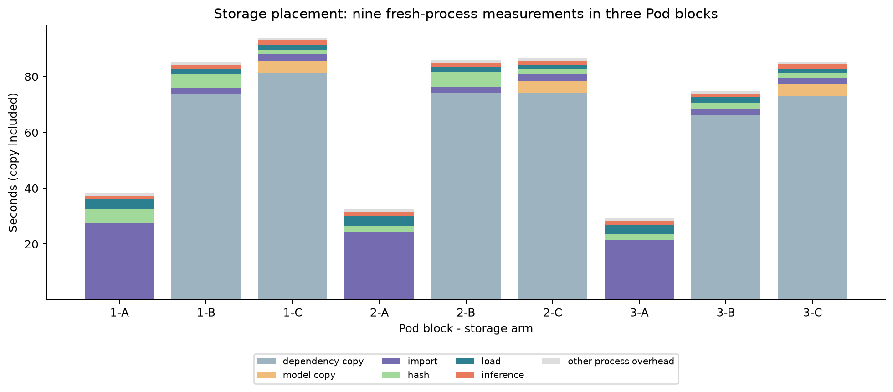
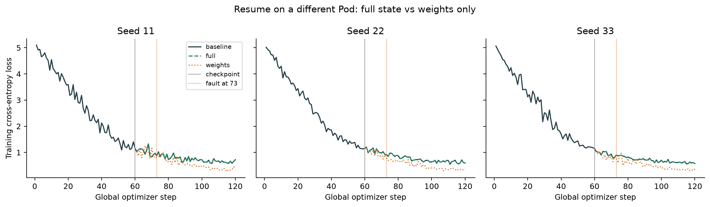
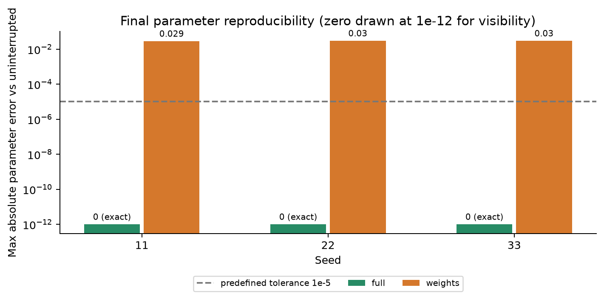

# 추가 실험 결과

실행일: 2026-10-24. 발표 예정: 2026-10-27(화).

## 결론

- 준비시간 중앙값: A 32.49초 / B 85.27초 / C 86.56초. 복사시간을 포함한다.
- 블록별 비율의 중앙값으로 본 개선율: B -156.2%, C -166.4%.
- 전체 상태 학습 복구: 사전 허용오차와 batch 순서 기준 3/3 seed 통과.
- 아래 결과는 각각 작은 고정 추론과 합성 데이터의 작은 Transformer에 한정한다.

## 공통 실행 조건

NVIDIA L4 1개, EU-RO-1, On-demand 견적 $0.59/h. 생성 직전에도 가격을 확인했으며 고정 RTX5090 상한 $1.19/h 이내다. 실제 Torch는 `2.8.0.dev20250319+cu128`, CUDA `12.8`, 저장소 측정 드라이버는 `595.91.07`. 추론은 기존 Qwen2.5-1.5B-Instruct의 고정 revision·이미지 digest·BF16·greedy 설정을 사용했다. 학습은 별도 작은 모델의 FP32 작업이다. 세부 설정과 소스 hash는 `records/followup/frozen-config.json`, `preregistered.json`에 있다.

## 1. 준비 지연의 원인: 저장 위치별 비교

A=의존성·모델 모두 network volume, B=의존성만 `/tmp`, C=의존성·모델 모두 `/tmp`. 3개 새 Pod 안에서 각 군을 새 프로세스로 한 번씩 실행했다. 순서는 ABC/BCA/CAB다. 각 군마다 새 Pod를 생성한 비교는 아니며 provider·OS 캐시를 비우지 않았다.

표의 전체시간은 원격 worker가 staging을 시작하기 직전부터 결과를 산출할 때까지다. 복사와 자식 프로세스의 전체 import를 포함하지만 부모 Python의 초기 표준 라이브러리 import·인자 파싱은 제외한다. wrapper가 측정한 프로세스 전체 수명과 로컬 왕복시간도 각 실행의 `exit.json`, `controller.json`에 별도로 보관했다.

| 블록 | A 전체 초 | B 전체 초 | C 전체 초 | B/A | C/A |
|---|---:|---:|---:|---:|---:|
| 1 | 38.36 | 85.27 | 93.77 | 2.223 | 2.444 |
| 2 | 32.49 | 85.79 | 86.56 | 2.641 | 2.664 |
| 3 | 29.25 | 74.93 | 85.37 | 2.562 | 2.919 |

각 막대는 평균이 아닌 실제 한 측정이다. 모델 SHA-256은 9/9, 생성 토큰은 9/9 기준 출력과 일치했다. 상대 개선율의 음수는 악화다. 각 대안의 사전 20% 개선 기준: B 미충족, C 미충족.

| 군 | 복사 중앙값 초 | import 중앙값 초 | hash 중앙값 초 | 로드 중앙값 초 | 추론 중앙값 초 |
|---|---:|---:|---:|---:|---:|
| A | 0.00 | 24.44 | 2.06 | 3.56 | 1.29 |
| B | 73.56 | 2.29 | 5.07 | 1.81 | 1.57 |
| C | 78.24 | 2.40 | 1.73 | 1.52 | 1.58 |

이 열별 중앙값의 합은 전체 중앙값과 반드시 같지 않다. 부트·최초 설치·다운로드는 공통 준비비이며 위 표에서 제외했다. Pod별 SSH 시간은 `records/followup/pod-*.json`, 공통 설치·다운로드는 `dependency-install.json`과 `prepared.json`에 있다.

이번 A도 사전 준비한 snapshot 경로를 직접 읽고 offline 모드로 로드한다. 기존 프로토타입의 매회 snapshot 조회·설치 확인과 동일한 전체 제어 흐름은 아니다. 따라서 이전 실험과 이번 시간 차이를 저장 위치의 인과 효과로 주장하지 않으며, 기존 5분 유지/삭제 정책을 다시 측정한 결과도 아니다.

### 같은 Pod에서 복사한 파일을 여러 번 재사용한다면? (계산 예측)

같은 Pod에서 매회 새 Python 프로세스로 모델을 로드하되 최초 복사 파일을 재사용한다고 가정하면, `복사시간 + N × (측정 전체시간−복사시간)`과 `N × A 전체시간`을 비교할 수 있다. 각 블록으로 계산한 손익분기 호출 수는 다음과 같다. None은 양의 절감이 없어 유한 값을 제시하지 못한다는 뜻이다.

| 대안 | 블록 1 | 블록 2 | 블록 3 |
|---|---:|---:|---:|
| B | 3 | 4 | 4 |
| C | 3 | 4 | 4 |

**이 표는 반복 재사용 실측이 아니다.** 캐시·입출력 부하가 일정하다는 가정이 필요하며 GPU에 모델을 계속 상주시킨 유지형이나 요청 묶음 정책의 결과로 해석하면 안 된다.

## 2. Pod 삭제 후 학습 복구

작은 자체 causal Transformer(2층, hidden128, 4 heads, vocabulary128, sequence64, batch8), FP32 AdamW,120 step을 실행했다. 학습 파라미터 수는 306048개다. 합성 next-token 데이터이므로 대형 언어 모델 fine-tuning 품질 실험으로 해석하지 않는다.

각 seed에서 무중단 120 step과 별도로 73 step에서 프로세스를 예상 종료 86으로 끊었다. 저장은 20-step 주기여서 최신 확정 파일은 60 step이다. **13 step을 잃었고 재개 때 다시 계산했다.** 기존 Pod를 실제 삭제하고 다른 ID의 Pod에서 전체 복구(F)와 가중치만 복구(W)를 수행했다. W는 optimizer·scheduler·RNG·batch 순서가 모두 초기화되어 단일 요소의 효과를 분리한 실험은 아니다.

| seed | 무중단 평가 loss | 전체 복구 평가 loss | 가중치만 평가 loss | F 파라미터 최대오차 | W 파라미터 최대오차 | F 기준 |
|---|---:|---:|---:|---:|---:|---|
| 11 | 0.493796 | 0.493796 | 0.244423 | 0 | 0.0286 | 통과 |
| 22 | 0.572482 | 0.572482 | 0.202971 | 0 | 0.0302 | 통과 |
| 33 | 0.479320 | 0.479320 | 0.257574 | 0 | 0.03 | 통과 |

가중치만 복구했을 때 평가 loss가 더 낮게 나와도 같은 학습을 재현한 것은 아니다. 여기서의 성공은 최종 성능 경쟁이 아니라 무중단 궤적 복원이다. 실제 W는 scheduler도 초기화하여 재개 첫 learning rate가 0.001이고 F는 0.0005였다. 데이터 순서도 달라 낮은 평가 loss의 원인을 한 요소로 돌릴 수 없다.

| seed | F 체크포인트 로드 초 | F 나머지 60-step 학습 초 | F 최대 loss 오차 | F batch 순서 일치 |
|---|---:|---:|---:|---|
| 11 | 0.048 | 0.662 | 0 | True |
| 22 | 0.038 | 0.683 | 0 | True |
| 33 | 0.037 | 0.621 | 0 | True |

새 Pod 생성 요청 직전부터 첫 seed 복구 결과의 로컬 회수까지 51.4초였다. 이 값에는 새 Pod 기동·프로세스 import·남은 학습·회수가 포함된다. 나머지 seed들은 같은 Pod를 공유했으므로 각각 새 Pod를 만들었을 때의 독립 end-to-end 복구시간이라고 주장하지 않는다.

60-step checkpoint와 기준 최종 상태는 S3 전체 객체로 로컬 백업했다. `backup-manifest.json`에 bytes/SHA-256을 남겼다. F/W의 최종 상태 6개도 S3 전체 객체로 추가 백업했고 결과 hash와 대조했다(`recovered-states-backup-manifest.json`). 대형 파일은 Git 제외 경로 `private/followup-backups/`에 보관한다. 모델 다운로드 파일과 달리 학습 데이터·가중치는 직접 생성한 것이다.

## 3. 비용·실패·정리

Pod 수명×견적 비용 추정 $0.2508, container disk 추정 $0.0012, network volume 연속시간 환산 추정 $0.0008. 합계 약 $0.2528다. 견적에 디스크가 포함됐는지에 따라 중복 가능성이 있으며 공급자 확정 청구가 아니다. Network volume은 시간 단위 과금이므로 연속시간 환산과 실제 청구는 다를 수 있다. 세금·에이전트 비용은 포함하지 않았다.

관측 계정 잔액 감소: $0.2053. 계정 전체 관측으로 실행별 확정 청구와 구분한다. 최종 계정 Pod 0개, network volume 0개, 시간당 사용액 $0.

추가 실행의 공급자 usage 조회에는 아직 7개 Pod 중 0개의 내역만 나타났다 (`records/followup/billing-partial.json`). 확정 비용은 알 수 없으며 0달러라는 뜻이 아니다.

각 fault 실행의 종료 86은 계획된 주입이다. 계획 밖 오류가 있으면 `execution-error.json`, `pod-*-failure.json`, `attempts/`와 수정 기록을 함께 확인한다. 실패와 재실행 비용은 최종 합계에서 제외하지 않는다. 이번에는 비교 측정 전 준비 단계에서 SFTP가 없는 선택적 결과 파일의 빈 로컬 파일을 남겨 JSON 파싱에 실패한 1회가 있었다. 이를 수정하고 전 자원을 삭제한 뒤 재시작했다. 실패한 첫 시도의 Pod 비용 약$0.0422도 위 합계에 포함했다. 상세 실행 차이는 `docs/followup/실행기록.md`에 있다.

### 기존 실험 청구의 사후 확인

2026-10-24에 기존 10월 17일 실험의 공급자 usage를 다시 조회했다. 알려진 17개 Pod 모두 사용 내역이 나타났고 Pod usage 합계는 $0.4418였다. 당시 GPU 수명 추정 $0.4446과는 수집 경계·디스크 포함 여부가 달라 완전히 같은 비용 범주라고 단정하지 않는다. Network volume은 계정 시간창 집계만 제공되어 실행별로 나누지 않았다. 이 자료도 세금 포함 최종 청구서 확인과는 다르다. 증거는 `original-billing-recheck.json`이며 기존 보고서는 당시 관측 기록으로 유지했다.

## 4. 해석의 한계와 다음 단계

- 표본은 저장소 3 Pod 블록, 복구 3 seed와 한 쌍의 전후 Pod다. 일반적 실패율·p95를 추정할 수 없다.
- 새 Pod ID가 서로 다른 물리 호스트를 의미하지는 않는다. 물리 호스트 이동을 별도로 검증한 실험은 아니다.
- 저장 경로 효과는 지역·volume 상태·기존 파일 캐시와 함께 달라진다. `/tmp`가 별도 파일시스템임은 원본 `environment.filesystems`로 확인한다.
- FP32 작은 단일-GPU 모델의 복구가 성공해도 BF16 LLM·AMP scaler·분산 sampler·다중 GPU 상태까지 검증한 것은 아니다.
- 전체 상태와 가중치만 비교는 여러 상태를 동시에 바꾼다. 어떤 상태가 차이의 주원인인지 알려면 optimizer/RNG 등의 개별 제거 비교가 필요하다.
- 저장 주기를 여러 값으로 바꾸거나 혼합 유지 정책을 실제 trace에서 비교하는 것은 후속 후보이며 이번 실측으로 주장하지 않는다.

설계·계획은 `docs/followup/`, 선정 과정은 `추가실험-아이디어선정.md`, 원자료는 `records/followup/`다. 참고: [RunPod 가격](https://docs.runpod.io/pods/pricing), [PyTorch checkpoint](https://docs.pytorch.org/tutorials/recipes/recipes/saving_and_loading_a_general_checkpoint.html).
