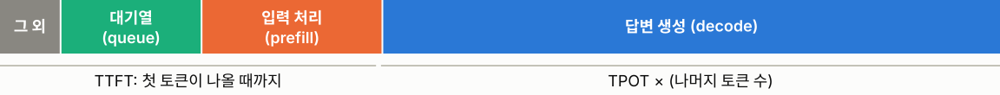
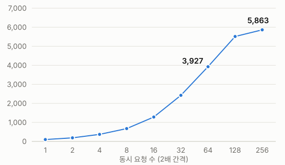
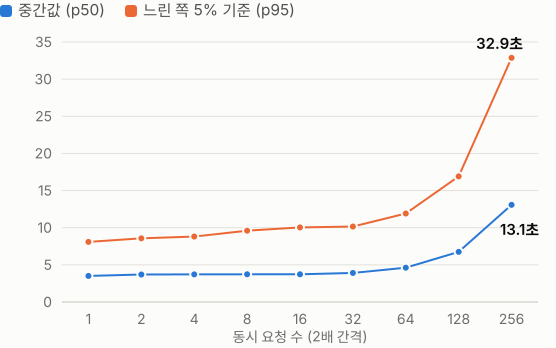
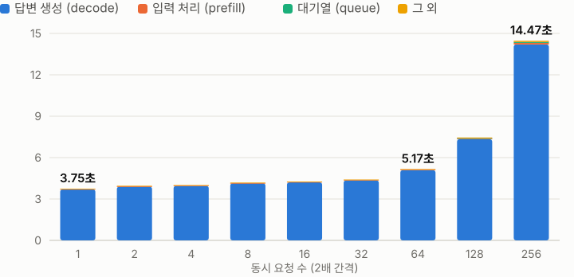

# GPU 한 장으로 동시 요청을 얼마나 처리할 수 있을까?

RTX 5090에서 한국어 LLM 서빙의 한계와 병목 측정

1차 실험 · Kanana 1.5 8B · vLLM · RunPod · 2026년 11월

---

**목적과 핵심 질문**

## GPU 한 장의 서빙 한계와 구간별 소요 시간 파악

**질문 1. 동시 요청 수를 늘려도 GPU가 처리하는 양이 거의 늘지 않는 지점은 어디인가?**

서버가 동시에 처리하는 요청 수를 1~256으로 늘려 측정했다.

**질문 2. 답변이 눈에 띄게 느려지기 시작하는 동시 요청 수는 몇인가?**

답변이 끝날 때까지 걸린 시간(latency)을 동시 요청 수별로 비교했다.

**질문 3. 답변 하나를 만드는 동안 어느 단계가 가장 오래 걸리고, 동시 요청이 늘면 어느 단계가 느려지는가?**

대기열(queue), 입력 처리(prefill), 답변 생성(decode)으로 나눠 확인했다.

---

**실험 설계**

## 동시 요청 수만 변경, 나머지 조건 고정

| 항목 | 내용 |
|---|---|
| GPU | RTX 5090 1장 (32GB) |
| 플랫폼 | RunPod, 시간당 GPU $1.19 |
| 모델 | Kanana 1.5 8B Instruct 2505 (BF16) |
| 서빙 | vLLM 0.26.0, 기본 설정 |
| 데이터 | 한국어 ShareGPT 6,014건 |

| 항목 | 내용 |
|---|---|
| 도구 | vllm bench serve, 채팅 API |
| 요청 방식 | 지정한 동시 수를 항상 유지 |
| 동시 요청 | 1, 2, 4 … 128, 256 (9단계) |
| 반복 | 단계별 3회, 총 27회 |

> vLLM 기본 설정을 썼고, 토큰 선택 기능(FlashInfer 샘플러)만 기본값과 다르게 설정했다.

---

**무엇을 쟀나**

## 답변 완료까지의 단계별 소요 시간 측정

- **TTFT** 첫 토큰이 나올 때까지
- **TPOT** 토큰 하나를 만드는 시간
- **latency** 답변이 끝날 때까지 걸린 시간
- **throughput** GPU가 1초에 처리하는 양

> 사용자가 느끼는 속도와 그 원인이 되는 단계를 함께 봤다. 그림의 단계 폭은 설명용이다.

---

**결과 1**

## 동시 요청 128~256 사이에서 처리량 증가 정체, 답변 시간 증가

**GPU가 1초에 생성한 토큰 수**

3회 평균

**답변이 끝날 때까지 걸린 시간 (latency, 초)**

> 64까지는 답변 시간이 거의 그대로다(중간값 3.5초 → 4.6초). 128 → 256은 처리량 +7%, 답변 시간은 약 2배다.

---

**결과 2**

## 전체 시간의 약 98%가 답변 생성(decode) 단계

**답변 하나당 평균 시간 (초)**

| 동시 | 메모리(KV) 사용률 | 토큰당 시간 |
|---:|---:|---:|
| 64 | 23.6% | 15.1ms |
| 128 | 45.0% | 21.7ms |
| **256** | **88.9%** | **42.3ms** |

대기열과 입력 처리는 최대 0.07초, 0.11초다. 서버가 여러 요청을 한 묶음으로 처리해 **요청마다 GPU를 나눠 쓰느라** 답변 생성이 느려진다.

> 느려지는 원인은 GPU 연산이고, 동시 256에서는 메모리(KV 캐시)도 최대 99.9%까지 찼다.

---

**결론**

## RTX 5090 한 장, 동시 64건까지 체감 유지

| 동시 요청 | 관찰 |
|---|---|
| **64까지** | **답변 시간 중간값 약 4.6초, 체감 거의 유지** |
| 128 | 중간값 약 6.8초, 느린 쪽 5% 기준 약 16.9초 |
| 256 | 실패 없음, 중간값 약 13.1초, 느린 쪽 약 32.9초 |

- 질문 1: 동시 128~256 사이, 초당 약 17건에서 처리량이 거의 늘지 않았다.
- 질문 2: 답변 시간 중간값은 64까지 3.5초 → 4.6초, 128에서 6.8초, 256에서 13.1초였다.
- 질문 3: 답변 생성(decode)이 약 98%이고 3.70초 → 14.20초로 가장 많이 늘었다.

**이 결과의 한계**

- 동시 수를 고정해 대기열 지연이 덜 드러남
- 부하 도구가 GPU와 같은 Pod에서 실행됨
- 단일 턴, 시스템 프롬프트 없는 요청
- 측정 범위는 LLM 서버까지
- FlashInfer 샘플러를 끈 조건

> GPU가 처리할 수 있는 양은 초당 약 17건(약 5,900토큰)이고, 줄여야 할 단계는 답변 생성(decode)이다.
